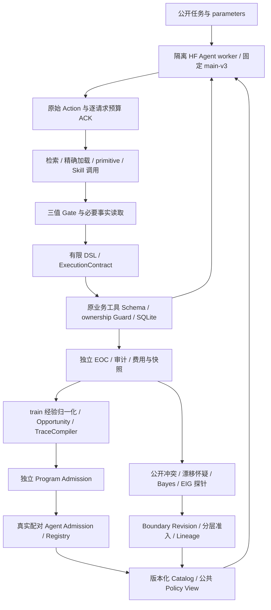

# SkillForge 面试技术简报

2026-10-13 最终交付版。所有新算法开发、真实模型实验和 Prompt 调整已停止。本简报区分 **实现存在**、**CPU 工程验证**、**真实模型观察**、**正式研究结论**；未来假设仅作面试讨论，不是待自动启动的任务。

## 30 秒项目介绍

SkillForge 是受控电商 SQLite 沙箱中的 Agent 技能学习与治理系统。固定 main-v3（实际记录为 Qwen3-4B-NF4-SFT），一条主线从真实交互归纳可执行程序，另一条主线主动探测已有程序的业务适用边界。两条线都经过独立验证、版本治理和失败回退。项目最重要的发现是：**边界学对、程序验证通过、Agent 正确调用、完整任务成功，是不同问题。** 目前已观察到新程序的真实复用，但未完成开放世界自主进化或新 dossier Skill 的正式 Agent 准入。

权重身份固定为 `f195fe00128aa86587b5b37b5a3940116276966162d8f72c5bb222baf445669b`，见 [model-identity.json](../results/interview-sprint/20261013-v4/model-identity.json)。本轮交付不新增 SFT/DPO/RL。

## 1. 完整架构与两条主线

| 层 | 主要源码 | 具体职责与信任边界 |
|---|---|---|
| 模型执行 | [skill_evolution/model.py](../skillforge/skill_evolution/model.py)、[worker.py](../skillforge/skill_evolution/worker.py) | 固定 HF 权重生成一条 JSON Action；接收公共任务、目录、真实观察，不接收 fixture/gold/验收答案。 |
| 隔离 | [execution_aware/worker.py](../skillforge/execution_aware/worker.py) 的 `install_guard` | 拒绝 Agent 导入 scripts/evaluator、读取私有文件、建立网络或启动外部进程。来源 hash 在 Guard 安装前计算，后续只传惰性身份。 |
| 目录与检索 | [skill_evolution/catalog.py](../skillforge/skill_evolution/catalog.py) | 不可变版本、词法检索、精确 ID/revision 加载、依赖闭包；加载不等于适用。 |
| 执行 | [skill_evolution/runtime.py](../skillforge/skill_evolution/runtime.py)、[skills.py](../skillforge/skills.py) | primitive 与 Skill 共用工具能力；Gate 为 APPLICABLE/INAPPLICABLE/UNKNOWN；DSL 支持 call/assert/finish。 |
| 执行契约 | [execution_aware/contracts.py](../skillforge/execution_aware/contracts.py) | mutation 状态、读回义务、VerificationReceipt、未知提交恢复；Runtime intervention 单独计数。 |
| 环境与 EOC | [environment.py](../skillforge/environment.py)、[verifier.py](../skillforge/verifier.py)、[interview_sprint/workflows.py](../skillforge/interview_sprint/workflows.py) | 工具自己执行权限检查；独立 EOC 用初态/真实返回/终态验证目标，候选不能给自己定义成功。 |
| 治理与证据 | [evolution_common/artifacts.py](../skillforge/evolution_common/artifacts.py)、[skill_evolution/registry.py](../skillforge/skill_evolution/registry.py) | 来源 split 单一归属、内容寻址记录、预算、父链、保留/回滚；Registry 选择与生产部署分离。 |
| 可视化 | [skill_evolution_workbench/](../skillforge/skill_evolution_workbench/) | 只读展示原始 Trace、漏斗、验证及成本，不是独立学习证据。 |

**程序线学“怎么做”**：改变可执行程序结构。**边界线学“何时可做”**：保持程序与不可变安全底线，单独修订业务适用规则。论文里的 RL policy、业务 Policy View、Bayesian belief 是不同对象；项目最近的演化未更新模型参数。

## 2. Trajectory → Opportunity → Skill → 两级准入

1. **先声明任务/EOC与来源。** train/dev/validation/test 的 source group、对象和实体归属进入 SplitLedger；只有 learn/train 可进入编译。三个共享模板的不同实体来源不代表三个独立环境。
2. **保留真实交互。** 原始 messages、response、Action、tool audit、决策来源、SQLite 快照、模型请求的 reservation/settlement 均保存。真实模型 provenance 与 CPU scripted 测试明确区分。
3. **归一化。** `normalize_calls` 仅把能唯一匹配公开参数的实际值替换为 `$input.<name>`；有歧义就拒绝。记录每个节点的 trajectory_id/audit_index、返回值 hash 和 origin，不读取 before/after 私有快照来构造模式。[experience.py](../skillforge/skill_evolution/experience.py)
4. **机会筛选。** 按精确有序参数化模式分组；至少三个独立 source group，已有程序结构/目标覆盖去重。预计收益 = 平均原模型 calls − 4，四次为 search/load/execute/stop，门槛至少节省一次。这个估计不是实测收益。
5. **TraceCompiler。** 重核原轨迹、来源及效用；逐节点保留观察顺序和来源。当前只支持 order_id 参数的直线只读子集，最多 12 节点；不按 workflow_id 输出预写程序，不臆造缺失步骤，也不证明重排语义等价。末端 finish 来自已独立验证的 completed outcome。[compiler.py](../skillforge/skill_evolution/compiler.py)
6. **Program Admission。** 静态 DSL/绑定/来源检查，再在独立 SQLite 沙箱执行 Positive、Boundary、Negative、Fault；重放独立 EOC。程序 postcondition 能表达身份，但商品列表和完整事实仍须外部 EOC。CANDIDATE→VERIFIED 产生新 hash，不改原候选字节。[validation.py](../skillforge/skill_evolution/validation.py)、[registry.py](../skillforge/skill_evolution/registry.py)
7. **Agent Admission。** 固定模型、Runtime、任务、初态、预算，配对旧/新目录；先硬性拒绝安全问题及旧成功退步，再比较独立来源的 EOC/成本。成本收益要求双方均成功；来源数至少六、至少一个 stable case、预算完整结算；单侧 sign test 不足就 INCONCLUSIVE。数学门通过仍需真实原始证据审计，不能直接部署。[admission.py](../skillforge/skill_evolution/admission.py)

若按来源聚合后 wins=w、losses=l、n=w+l，代码使用 `p=sum(C(n,k), k=w..n)/2^n`；ties 不提供比较信号，但保留在固定分母和来源数中。这不是把一个 seed 内的几十个 tasks 当独立试验。主报告的零候选、拒绝和无收益均为有效出口。

**真实例子**：六条训练轨迹自动产生 `trace_dae7a91522975618`，程序为 `get_customer → get_order → get_order_items → get_payment → get_shipment → finish`；每个读取均由公开 order_id 绑定，逐节点有六个来源。它不是把原 cancel/refund/address 的固定 family 编译器换个 ID。[候选来源](../results/interview-sprint/20261013-v4/candidate-screen.json)

## 3. Bayesian Boundary Learning 与版本治理的实现

### 有限假设与后验

[evolution_schemas.py](../skillforge/evolution_schemas.py) 的假设包括 no_change(H0)、restrict、relax 和 OTHER；公开谓词在预声明字段/取值范围内。预测值 True/False 表示可执行性，**不是 stop/refuse/escalate 终态标签**。immutable Guard=False 总是不能执行，Boundary relax 不能覆盖权限底线。

[belief.py](../skillforge/belief.py) 的 `BeliefState`：OTHER 默认先验 0.1，其余结构化先验按 `exp(-lambda × 谓词数)` 归一化；观测模型默认 accuracy=0.99，预测命中似然 0.99、冲突 0.01、不可判定/OTHER 0.5。保存 log weight，用减最大值的 log-normalization 避免下溢：

`log w_t(h) = log w_(t-1)(h) + log P(y_t | h,x_t)`。

unknown 进入历史但不更新后验；重复 trajectory 不重复计数，冲突重放拒绝；policy epoch 不混用。**这个 posterior 只是在人工声明的有限观测模型下的概率，不是校准过的真实规则置信度。**

### EIG、探针与收敛

[active_learning.py](../skillforge/active_learning.py)：对候选的二值观测枚举后验，`EIG(x)=H(p)-Σ_y P(y|x)H(p(.|x,y))`，熵使用自然对数。排序分数为 `EIG − 0.01×cost − 0.01×mutation_probability`（默认参数），平分按 candidate_id 决定。只在授权沙箱执行候选，探针的真实工具观察才进入 EvidenceView；候选请求不等于已发生证据。

收敛按声明候选支持及已有观测上的**预测等价类**合并概率；默认类质量≥0.95、类熵≤0.15 nat、OTHER≤0.05，并要求至少有有效证据且与全部有效观测相符。预算最多 20 queries。无收敛者 RMQ 计 cap=20，不能把“提前放弃只花六次”当成六次成功收敛。

[execution_aware/challenge.py](../skillforge/execution_aware/challenge.py) 的 H0 Challenge 要求真实 explore probes 区分 H0 与较高后验非 H0，默认 K=2、替代质量阈值相对最强非 H0 为 0.1；seed/unknown 不抵扣义务，仍占原 20-query 预算。**实现存在不代表有效**：v1.1-B 的 active/active_v2 均 23/30 收敛、RMQ=8.8667，186 条 v2 查询中 Challenge 未触发，没有改善证据。[正式 B](EXECUTION_AWARE_V1_1_DELIVERY.md)

[boundary_evolution/acquisition.py](../skillforge/boundary_evolution/acquisition.py) 的 BroadThenDeep 是开发候选：先按未覆盖公开因素、再按原 EIG 排序；Deep 仅在公开冲突后生成已有假设阈值邻点/单因子对照/有限独立重复。不是 LLM 自由发现新因果图。开发消融未选择它进入 P11 的有效新方法；正式结果不伪造 ImprovedActive。

### Boundary Revision、父链和准入

[boundary_evolution/trigger.py](../skillforge/boundary_evolution/trigger.py) 在有界公开窗口中识别归因明确的冲突，默认至少三个独立来源及不同对象；timeout、参数错误、权限拒绝、程序错误、终态错误不教成业务边界。epoch 标签不直接触发更新。

[boundary_lineage/proposal.py](../skillforge/boundary_lineage/proposal.py) 从 Bayes 历史和真实 explore 回执重新认证有限支持，不相信调用者的 converged flag；OTHER、域不足、未知过多或 H0 challenge 不足均弃权。Boundary 是相对冻结原业务规则的**绝对替换**，H0 表示恢复原规则，不是永远保留上一 epoch，也不是不断 OR/AND 旧 patch。

[boundary_runtime/catalog.py](../skillforge/boundary_runtime/catalog.py) 把程序 revision/procedure hash、Boundary revision、support_domain 和 immutable Guard 绑定为 bundle_hash。支持域外返回 UNKNOWN，不能凭空宣称全局规则等价。

[boundary_lineage/controller.py](../skillforge/boundary_lineage/controller.py) 只让逐级通过独立 Boundary gate、Agent gate 和原始证据审计的版本成为下一父节点；拒绝时保留实际父库。阶段记录可重放，陈旧父版本拒绝，发布失败恢复内存父节点。隔离激活与生产部署分开。

[skill_evolution/governance.py](../skillforge/skill_evolution/governance.py) 分开 program/boundary/metadata revision；metadata 不能改行为，program revision 不能夹带边界变化，Boundary revision 必须保持程序。精确 DSL/input-renaming fingerprint 用于去重；粗 effect_signature 只能标记潜在重复，不能证明重排等价。RevisionMemory 只接收 train/dev，默认每父最多两个尝试，不能把 formal test 反馈喂回优化器。

## 4. 最近三次有数据支持的研究推进

这里的“推进”包括有价值的阴性结果，不把工程完成包装成算法突破。

| 推进 | 已验证数据 | 解释与边界 |
|---|---|---|
| P11 连续工程验证完整结算 | CPU 90/90；72 个真实物理臂、12 阶段；最终两种方法 test EOC 均 11/24；12→0 Belief→0 Boundary→0 Agent→0 Activated | 连续框架/审计交付完成，但没有真实 Agent 适应增益或连续激活链。OriginalActive 的 CPU 收敛率 0.4444、RMQ 14.2222；ExistingActiveV2 为 0.2778、16.4444，不能声称 v2 更好。 |
| 真实新程序生成 | 六训练来源、36 decisions、97,968 tokens，自动产生一个五读 Skill；八个独立程序沙箱通过 | Program Admission=ADMITTED。原 validation+held-out 每组三源方法各 19/19 EOC、96 calls，search/load/use 全零；真实 Agent 原条件增量为零。 |
| Schema Exposure 下首次复用新程序 | 三新 dev 来源 A/B/C 共九臂；A EOC 1/3、32 calls、155,388 tokens；B/C 均 3/3、各六 calls，23,458/25,246 tokens；全部 235 checkpoints 审计通过 | B/C 六个臂均由模型正确填 ID/参数，通过旧 type=skill 执行新程序并 stop；直接 execute_verified_skill 调用为零。只有一个来源双方均成功，10→2 calls；不是全样本有效完成成本因果估计。 |

证据：[P11 正式报告](BOUNDARY_EVOLUTION_FORMAL_ENGINEERING.md)、[新程序完整报告](INTERVIEW_SPRINT_RESULTS.md)、[Schema Exposure 报告](INTERVIEW_SKILL_INVOCATION_REPORT.md)。最近两项 Sprint 的累计模型费用为 1,629,575 tokens，**不是整个项目累计**。

作为历史参照：Stage 1 三轮正式 learn 18/18、test A/B/C 各 18/18，但零候选/零 C−B 增量。[Stage 1](SKILL_EVOLUTION_STAGE1_FORMAL.md) 另一个历史协议 v1.1-A 有 9 个 world-seed、1,608 条真实执行，旧 Runtime 0/9、新 Runtime 3/9 隔离 Agent 准入；changed-test Runtime effect +0.2639、Bundle effect +0.0417，但连续 epoch 有一次 stable 退步，完整 retention 未通过。不能将“本次新 Skill 未准入”误说成“所有历史隔离 Bundle 从未准入”。[v1.1 交付](EXECUTION_AWARE_V1_1_DELIVERY.md)

## 5. 检索、ID、输入绑定的真实失败根因

| 观察到的错误 | 原始证据支持的直接原因 | 未得到证明的解释 |
|---|---|---|
| NO_SEARCH | 原主三组对照未调用可用 search_skills；追加公开接口说明的九臂仍零检索/加载。模型选择 primitive 路径。 | 不能推出检索索引不可用，或任何新提示都必然无效。 |
| 错误 ID | 预加载后 Action.name=`Order investigation dossier`；LoadedSkills 以精确 skill_id 为键，返回 skill_not_loaded。可见性 dev 五次，metadata 旧名 dev 六次。 | 不能归因于 SQLite、候选程序缺失或 Runtime 拦错了合法 ID。 |
| 缺参 | metadata 精确名三次均生成正确 ID，但 arguments={}；上下文已有 parameters.order_id 与 inputs 列表，严格绑定比较拒绝。 | 没有证据证明 tokenizer、权重记忆或某特定 attention 机制导致错误。 |
| 错误对象 | 最新 A 两个案例把订单 ID 写成错误值，真实 get_shipment 返回 not_found；完整 EOC 仍失败。 | 原 policy-attempt=0 不表示对象正确，更不能隐藏这两个尝试。 |

[预加载/主报告](INTERVIEW_SPRINT_RESULTS.md)、[metadata 原始 Action](INTERVIEW_REFERENCE_RESULTS.md)、[最新全部九臂与错误对象](INTERVIEW_SKILL_INVOCATION_REPORT.md)。这些是执行层诊断，不能将任意失败都解释成 Boundary 没学对。

## 6. 为什么旧路径成功、新工具未调用

[skill_invocation/adapter.py](../skillforge/skill_invocation/adapter.py) 根据已加载 VERIFIED 合约的实际业务工具引用推导 inputs 类型/约束，去掉默认值，并在新工具 Schema 中提供精确 ID/revision。新增工具只要求显式选择和输入，不代填、不纠错、不绕 Gate。[runtime.py](../skillforge/skill_invocation/runtime.py) 复用原函数代码和工具能力，原始 Action 不变；19 项 CPU 测试覆盖正确/缺失/错误类型、未加载、错误与冲突版本、Gate、故障、权限及完整 RPC/快照链路。

**真实结果是 Schema 可见、直接工具选择为零、旧路径调用成功。** B/C 原始 Action 是 `{"type":"skill","name":"trace_dae7a91522975618","arguments":{"order_id":"真实公开订单ID"}}`，下一步为 stop。没有执行时补参或 ID 纠正；实际五个工具返回通过独立 EOC。

最保守的解释是：新的结构化上下文与正确旧路径调用同时出现。原系统 Prompt 仍示范 type=skill，模型继续采用熟悉的 Action 形状是合理猜测，**尚未做机制消融，不能当作证实的心理/模型内部原因**。接口 Schema 与公开 A/B/C protocol 标签共同变化；本轮也没有 grammar-constrained decoding，不能把结果单独归因于 JSON Schema 某字段，更不能声称实际执行了新工具。

C 的公开推荐属于系统辅助候选发现，仍须模型选择、供参和终止；三组本来都有预加载。C−B calls 差为零，每例多 596 tokens，没有观察到额外推荐收益。新工具的严格执行回执仅有 CPU 工程验证，真实模型回执来自旧 DSL 事件，不混报。保守预登记的直接新工具 dev 门失败，未降低门槛、扩展测试或激活。[独立审计与漏斗](../results/skill-invocation/20261013-v2/independent-audit.json)

## 7. 与 SkillRL、RSIAgent、SAGE 的联系及差异

这里的 SAGE 特指统计接受门论文 arXiv:2609.36043，避免与同名 reasoning/memory/RL 项目混淆。下面依据原论文及本仓库源码比较，不代表复现论文成绩。

| 工作及论文 | 借鉴的研究问题 | SkillForge 实际实现/差异 |
|---|---|---|
| [SkillRL: Evolving Agents via Recursive Skill-Augmented Reinforcement Learning](https://arxiv.org/abs/2602.08234) | 经验抽象、分层 SkillBank 与检索；技能库在 RL 中与 policy 共同演化。 | 真实轨迹→严格可追溯 DSL 与库治理已实现；目前为受限直线程序、词法检索、固定权重。没有实现该论文的 SkillBank+RL 协同训练，没有对 ALFWorld/WebShop 复现。 |
| [RSIAgent: Autonomous Exploration for Recursive Self-improvement in New Environments](https://arxiv.org/abs/2609.15364) | training-free curriculum/actor/verifier，broad-then-deep 探索并冻结环境记忆供复用。 | 有受限 Broad/Deep 候选、公开冲突触发和可验证探针；不是多 Agent 自主生成开放环境课程。任务、字段域、EOC 由人预声明，探针多为受控固定程序；不声称复制其 OSWorld/ALE 结果。 |
| [SAGE: A Statistical Acceptance Gate for Self-Evolving Agents](https://arxiv.org/abs/2609.36043) | 逐题配对暴露退步，非对称惩罚与单侧检验减轻选择偏差，证据不足时弃权。 | 采用相同任务/初态的配对、来源级单侧 sign test、零退步/安全硬门和 INCONCLUSIVE。代码没有照搬论文全部 lambda 加权检验；算术 gate 也不代替真实审计或授权 Guard。 |

项目贡献更适合描述为**可审计的受限技能归纳、边界探索、版本准入与执行失败分解**，不宜声称提出了一个超过这些论文的通用学习算法。

## 8. 研究局限与可验证假设（未来，当前不执行）

| 未解决问题 | 可预登记的下一假设/对照 | 当前证据不支持什么 |
|---|---|---|
| Schema 的独立作用 | 保持公开 protocol 标签、原提示和输入一致，仅改变契约 Schema 的显示形式，使用全新 dev 来源 | 现有九臂不能定位 ID const、required inputs、描述文本或标签的单独效应。 |
| 直接 typed tool 未使用 | 在新独立协议比较描述式 Schema 与生成时约束解码；仍由模型选择 Skill/参数/终态 | 当前没有真实 execute_verified_skill 成功，也没有支持“强制工具就等于自主选择”。 |
| 真实检索 | 从无预加载状态比较自主检索与仅公开信息推荐，计入 search/load/候选错误和系统成本 | 当前六次新 Skill 复用不能证明自然发现。 |
| OOD/组合/程序复杂度 | 另行声明结构变化与独立 EOC，允许 no candidate；不能凭测试结果重排轨迹 | 六个训练来源共享模板；未证明开放世界或任意 Skill composition。 |
| Boundary 模型错设 | 独立更大状态域、OTHER 与无法区分假设的弃权测试，保持错误与预算分母 | 高 posterior 不保证真规则；H0 Challenge 未证明改善。 |
| 完整 Agent retention | 独立 world-seed 与多 epoch，固定 Runtime/权重，检验旧成功逐例退步 | P11 零激活，历史 v1.1 连续 stable 有退步；不能称无遗忘持续自进化。 |

其他限制：schema 推导覆盖已研究的标量输入/已加载固定版本，不支持任意类型/新合约语言；本 dev adapter 不宣称 checkpoint resume。零实际违规依赖环境 Guard；CPU 脚本验证不等于模型能力。GPU 利用小时多未实测，采集墙钟不冒充 GPU hours。近期 3 个 dev 来源无正式统计功效，不能报显著性。

## 9. 十五个面试追问与回答要点

1. **这个项目的自进化对象到底是什么？** 主要是可执行 Skill 程序及独立业务 Boundary/外部版本库；近期权重固定。程序线与边界线分开，业务 Policy 不等于 RL policy。
2. **怎么排除候选只是手写工具链换 ID？** 看原训练 messages/Action、每节点六个 audit_index、编译代码没有 family→序列模板。新 dossier 来自实际五读模式；旧三个业务 Skill 的有界 family 编译器单独承认。
3. **为什么至少三个来源还不够证明泛化？** 它防止单轨迹记忆，但三个实体可能共享同一模板/环境；真正泛化需要独立 source group、结构变化和未见任务。当前条件仍受限。
4. **为什么五读候选有机会而 Stage 1 零候选？** 发现、加载、执行、停止需四次决策；Stage 1 只有三/四次，预计不省。五读原轨迹六次，预计省二，但实测仍可能不检索或绑定失败。
5. **程序验证通过为何不能直接发布给 Agent？** CPU 已知输入可正确执行，不代表模型会选、填参、执行后正确终止。还需真实同状态配对的 EOC、安全、成本和 retention。
6. **Bayes 概率是不是“规则有 99% 正确”？** 不是。0.99 是预声明观测似然；后验只对有限假设/支持域成立，模型错设和 OTHER 都可导致假确信。保存原始证据并独立验收。
7. **EIG 怎么算，为什么加 cost/risk？** 对 binary outcome 枚举条件后验，计算期望熵降；扣除探针成本和 mutation 概率代理。在授权沙箱内选样；risk proxy 不替代真实权限检查。
8. **H0 如何主动证伪？** 在原预算内执行 K 个区分 H0 和高质量非 H0 的真实 challenge；unknown/seed 不抵扣。不够就弃权。正式 v1.1-B 未触发挑战，不能声称有效。
9. **timeout、permission_denied 能不能当负例？** timeout 是 unknown；权限拒绝属于不可变授权底线，不能学习成可放宽业务规则。只有归因明确的业务拒绝才给可执行性负标签。
10. **版本治理怎样防止坏候选污染父链？** 内容寻址、revision kind 约束、独立 split、候选/有效版本分离；审计及全部 gate 通过才更新当前父版本。拒绝、INCONCLUSIVE、rollback 均保留日志。
11. **提交成功但响应丢失会不会重复退款？** ExecutionContract 将其保留为 COMMIT_UNKNOWN；按 request_id 查账/read-back，只有 NOT_COMMITTED 才可重发。UNKNOWN 不能当没发生。原 receipt/重放保证义务不丢。[contracts.py](../skillforge/execution_aware/contracts.py)
12. **怎么避免把 Runtime 能力算成模型能力？** 分 autonomous_eoc/runtime_assisted_eoc、intervention、读回与自动终止来源；Skill 内部确定性工具也单列。历史 v1.1 Runtime effect 与 Bundle effect 通过 2×2 分析分开。[factorial.py](../skillforge/execution_aware/factorial.py)
13. **最新结果到底算成功还是失败？** 新 Schema 条件下 B/C 六个臂真的通过旧 Skill 路径复用程序；直接新工具调用为零、预登记门失败。保留两者，不能只讲“EOC 100%”或笼统说完全没用。
14. **3/3 对 1/3 是否显著？如何报成本？** 只有三个独立来源，A 有两次失败；不作显著性主张。完整支出全报，只有双方成功的改写来源能报 10→2 的有效完成成本差。C−B 未省 calls 且更贵。
15. **CI 为什么红，修复是否改变审计？** Git 中 SQLite 是 LFS pointer，旧 checkout 没下载实际对象，hash 自然不符。修复 checkout LFS 与只读字节核验；不改数据、审计或跳过测试，Ubuntu/Windows 独立给结果。[workflow](../.github/workflows/tests.yml)、[核验脚本](../scripts/verify_ci_sqlite.py)

## 面试前快速核对

先读本简报，再打开 [Invocation 全部数据与原始 Action](INTERVIEW_SKILL_INVOCATION_REPORT.md)；需要讲 Boundary 时看 [P11 最终结果](BOUNDARY_EVOLUTION_FORMAL_ENGINEERING.md) 和 [v1.1 的 Runtime/Bundle 分解及 retention 失败](EXECUTION_AWARE_V1_1_DELIVERY.md)。最新 Commit、双平台 CI、全部冻结证据完整性与停止声明以最终交付状态文件为准，不把历史运行中的进度页当现状。
